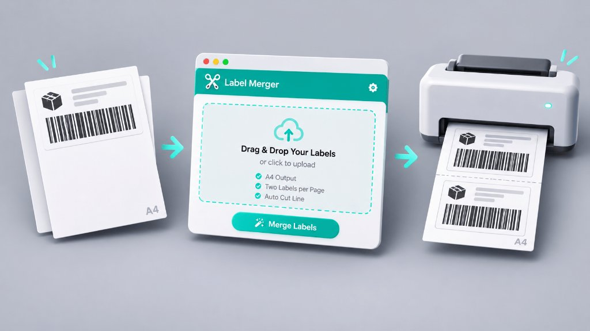

# 📦 好賣家宅配出貨單｜一頁兩張合併工具（離線版）



在列印宅配出貨單時，系統匯出的每一筆訂單通常都是一整頁 A4 的 PDF，但實際內容只佔用上半部，下半部完全空白。如果直接列印，印 6 筆訂單就要消耗 6 張 A4 紙，既浪費紙張也不方便整理。

這個小工具可以將多份單頁出貨單 PDF **自動合併為「一頁 A4 印兩張」** 的格式（例如：6 個檔案轉換後只需印 3 頁），並且 **100% 在本機瀏覽器離線運作**，不需安裝任何軟體、也不會將含有收件人個資的出貨單上傳到任何伺服器。

---

## ✨ 功能特色

- **🔒 100% 離線單一檔案**：整個工具濃縮在單一 `.html` 檔案內（已內嵌 PDF 處理引擎），無須連網、免安裝環境，點兩下即可在瀏覽器開啟使用。
- **🎯 保留原始向量條碼清晰度**：直接針對 PDF 頁面進行向量嵌入與排版，不轉檔壓縮，確保物流條碼清晰好刷。
- **✂️ 上下對半排列 & 裁切輔助線**：預設將第二張出貨單固定於 A4 下半部起點（正中央 50% 處），印出後**直接將 A4 紙上下對折即可精準裁切**，並可自選是否印出中央虛線裁切線。
- **📑 支援多檔拖曳與多頁拆解**：
  - 支援一次拖曳多個 `.pdf` 出貨單檔案（也可分批追加）。
  - 若單一 PDF 內含多頁出貨單，會自動拆解並兩兩配對。
  - 同時支援圖片格式（`.jpg` / `.png` / `.webp`）出貨單匯入合併。
- **👀 即時預覽與一鍵輸出**：畫面右側即時顯示合併後的 A4 預覽，可自由調整順序、微調垂直間距，並支援 **「直接列印」**（`Cmd/Ctrl + P`）或 **「下載合併 PDF」**。

---

## 🚀 使用方式

1. 下載本專案中的 [`出貨單二合一工具.html`](./出貨單二合一工具.html)。
2. 直接雙擊 [`出貨單二合一工具.html`](./出貨單二合一工具.html) 在瀏覽器（Chrome / Safari / Edge / Firefox）中開啟。
3. 將多筆宅配出貨單 PDF 檔案拖曳至左側 **「1. 加入出貨單檔案」** 區塊。
4. 在左側可檢視每筆出貨單分配的頁數與上／下半部位置，並可依需求調整順序或版面設定。
5. 點擊右上角 **「直接列印」** 立即印出，或點擊 **「下載合併 PDF」** 儲存合併後的檔案。

---

## 🛠️ 檔案結構

```text
.
├── 出貨單二合一工具.html   # 獨立運作的單一離線網頁工具（內含完整程式與 PDF 引擎）
├── banner.jpg            # 專案示意圖
└── README.md             # 專案說明文件
```

---

## ☕ 贊助支持

如果這個專案對你有幫助，歡迎請我喝杯咖啡！

[Buy Me A Coffee](https://buymeacoffee.com/dry4514) https://buymeacoffee.com/dry4514
